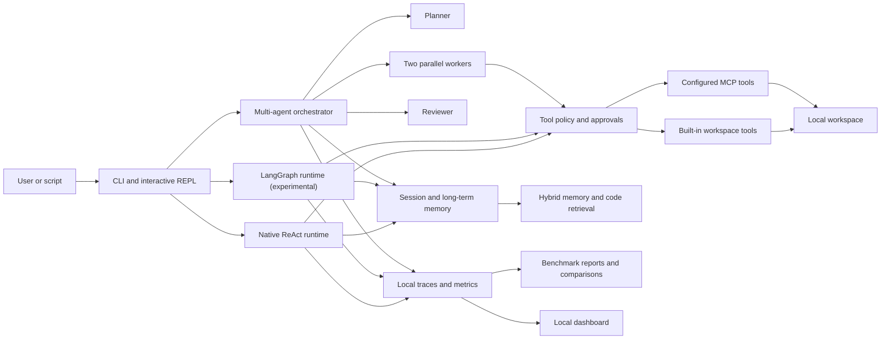

<p align="center">
  <a href="README.md">English</a> | <a href="README.zh-CN.md">中文</a>
</p>

# mikucli

**An evaluation-first local coding-agent runtime with policy-gated tools, hybrid code retrieval, multi-agent orchestration, and reproducible benchmarks.**

[](https://github.com/Manticore0918/mikucli/actions/workflows/ci.yml)


mikucli is a Python command-line agent for working inside a local codebase. It combines a ReAct loop, planner/worker/reviewer orchestration, explicit tool approvals, persistent memory, MCP integrations, local code retrieval, and an evaluation system built to answer a harder question than “did the demo work?”:

> **How reliably did the agent complete the task, what did it cost, and what changed between runs?**


[Quick start](#quick-start) · [Why mikucli](#why-mikucli) · [Architecture](#architecture) · [Evaluation](#evaluation-and-observability) · [Safety](#safety-model) · [Development](#development)

## At a glance

| Capability | What mikucli does |
| --- | --- |
| **Agent execution** | Runs a native ReAct agent or an experimental LangGraph-backed single-agent runtime. |
| **Multi-agent work** | Coordinates a planner, two workers, and a reviewer with dependency-aware parallel execution and bounded retries. |
| **Tool safety** | Classifies tool risk outside the model schema and requires approval before sensitive reads, writes, and shell commands. |
| **Code retrieval** | Builds a local tree-sitter and SQLite index, then combines embedding similarity with FTS/BM25 through reciprocal rank fusion. |
| **Memory** | Blends recent session context with persistent long-term memories and compresses older context as the token budget fills. |
| **Extensibility** | Loads explicit `$skill-name` instructions and connects configured MCP servers through the official Python SDK. |
| **Evaluation** | Runs repeatable benchmark trials with resumable checkpoints, failure categories, confidence intervals, latency, retry, token, and cost metrics. |
| **Observability** | Records local traces and exposes run comparisons through a browser dashboard. |

## Why mikucli

Many agent projects stop once a model can call tools. mikucli treats tool calling as the beginning of the engineering problem.

The project focuses on four areas:

1. **Controlled execution** — the runtime, rather than the model, decides which tools require approval and which roles may mutate the workspace.
2. **Relevant local context** — code and memory retrieval are explicit, local, inspectable, and protected by sensitive-path filtering.
3. **Comparable runtimes** — the native and LangGraph-backed loops share the same client, tools, memory, policy, and trace infrastructure.
4. **Measurable behavior** — benchmark reports capture success, failure categories, retries, latency, token usage, estimated cost, configuration, and runtime environment.

This makes mikucli useful both as a local coding agent and as a small laboratory for studying agent reliability.

## Quick start

```powershell
git clone https://github.com/Manticore0918/mikucli.git
cd mikucli
python -m venv .venv
.\.venv\Scripts\Activate.ps1
python -m pip install -e .
$env:MIKUCLI_API_KEY = "your-key"
mikucli "inspect this project and identify the highest-risk module"
```

Python 3.11 or newer is required. Run `mikucli` without a task to start an interactive session.

## Configuration

By default, mikucli reads shared credentials and defaults from `~/.mikucli/.env`. If that file is missing
and no API key is available from higher-priority config, mikucli creates it from the default template and asks
you to fill in `MIKUCLI_API_KEY`, then restart.

You can also create it yourself:

```powershell
New-Item -ItemType Directory -Force ~/.mikucli
Copy-Item .env.example ~/.mikucli/.env
```

```dotenv
MIKUCLI_API_KEY=...
MIKUCLI_MODEL=glm-5.2
MIKUCLI_BASE_URL=https://open.bigmodel.cn/api/paas/v4/chat/completions
MIKUCLI_CONTEXT_WINDOW_TOKENS=128000
MIKUCLI_EMBEDDING_PROVIDER=ollama
MIKUCLI_EMBEDDING_MODEL=nomic-embed-text
MIKUCLI_OLLAMA_BASE_URL=http://localhost:11434
```

The built-in defaults still select GLM through BigModel for backward compatibility. To use another provider, set
the API key, model name, and full OpenAI-compatible Chat Completions endpoint supplied by that provider:

```dotenv
MIKUCLI_API_KEY=your-provider-key
MIKUCLI_MODEL=provider/model-name
MIKUCLI_BASE_URL=https://api.provider.example/v1/chat/completions
```

Any model exposed through an OpenAI-compatible Chat Completions endpoint can be selected this way; mikucli does
not depend on a fixed model-name list. Native provider-specific protocols that do not offer this compatibility
shape are not supported by the built-in client.

Only `MIKUCLI_API_KEY` is required to start mikucli because the GLM model and endpoint remain the defaults. Hybrid
Memory Retrieval and Codebase Retrieval require the configured Ollama embedding service and model when they have
content to retrieve. `MIKUCLI_MODEL`, `MIKUCLI_BASE_URL`, `MIKUCLI_CONTEXT_WINDOW_TOKENS`,
`MIKUCLI_EMBEDDING_PROVIDER`, `MIKUCLI_EMBEDDING_MODEL`, and `MIKUCLI_OLLAMA_BASE_URL` are optional configuration
overrides. The legacy `BIGMODEL_API_KEY` and `BIGMODEL_BASE_URL` names remain supported as fallback aliases.

Workspace `.env` files are optional and merge over `~/.mikucli/.env` by key, so a workspace can override only
the settings it needs while reusing the global API key. You can also use environment variables:

```powershell
$env:MIKUCLI_API_KEY = "..."
$env:MIKUCLI_MODEL = "provider/model-name"
$env:MIKUCLI_BASE_URL = "https://api.provider.example/v1/chat/completions"
```

Config precedence is:

1. direct CLI flags like `--model`, `--api-key`, `--base-url`, and `--context-window-tokens`
2. direct environment variables like `MIKUCLI_API_KEY`, `MIKUCLI_MODEL`, and `MIKUCLI_BASE_URL`
3. file named by `--env-file`
4. file named by `MIKUCLI_ENV_FILE`
5. workspace `.env`
6. user config file `~/.mikucli/.env`
7. built-in defaults

File-backed config merges by key from lower to higher priority. To use a different `.env` file:

```powershell
mikucli --env-file C:\Users\you\mikucli.env
```

## Run

```powershell
mikucli "inspect this project and suggest the next step"
mikucli --workspace D:\Personal_Projects\mikucli
mikucli --model provider/model-name --base-url https://api.provider.example/v1/chat/completions
mikucli --context-window-tokens 128000
mikucli --runtime langgraph "inspect this project"
```

`--api-key` is available for one-off use, but an environment variable or env file is safer because command-line
arguments may be retained in shell history or visible to other local processes.

For a guided tour, start an interactive session and try:

```text
/index
/search how are tool approvals enforced?
/team
review the retrieval and memory boundaries
/eval run
/dashboard
```

See the [Slash Command Manual](docs/slash-commands.md) for every available command, its exact syntax, and
operational notes.

If no task prompt is provided, `mikucli` starts an interactive session. Interactive terminals use the full-screen
Terminal UI by default; redirected stdin or stdout uses the inline renderer. Pass `--no-tui` to start inline on an
interactive terminal. `/tui fullscreen` and `/tui inline` switch the current session without persisting the choice.

Interactive sessions start in built-in single-agent mode. Type `/team` to toggle multi-agent mode. Type `/mcp`
to toggle MCP mode. Type `/eval run` to run the eval suite benchmark harness in the foreground with per-case
completion details, `/eval run-single` or `/eval run-multi` to run the six cases for one agent mode,
`/eval run-stress` to run twelve harder cases across six stress tasks, `/eval run-stress-s` or
`/eval run-stress-m` to run the six stress cases for one agent mode, `/eval run-back` to run the core
suite in the background, and `/eval stop` to request a cooperative stop.
Background completion, failure, and report paths are printed automatically. Type `/lang-chn` to show the terminal
interface in Simplified Chinese, and `/lang-eng` to switch it back to English. The mode toggles are independent, so
the session can be in built-in single-agent, built-in multi-agent, MCP single-agent, or MCP multi-agent mode.

Pass `--runtime langgraph` to use the experimental LangGraph-backed single-agent loop. The default
`--runtime native` keeps the original implementation. Both runtimes use the same model client, tools,
approval policy, session memory, run logs, and local observability. Multi-agent `/team` mode continues to use
the native orchestrator while the LangGraph runtime is evaluated in parallel. `/eval run-single` uses the
selected single-agent runtime, so starting mikucli with `--runtime langgraph` runs all six single-agent benchmark
cases through `GraphAgentSession`.

Type `/dashboard` to start the local observability dashboard backend on `http://127.0.0.1:8765/` and open it in
your default browser. If the dashboard is already running, mikucli reuses it.

The full-screen `You:` composer remains anchored at the bottom while an agent turn is running. During active work
it accepts `/stop`, `/eval stop`, or a pending tool-approval response; ordinary prompts and other slash commands are available
again when the agent becomes idle. Type `/stop` or press `Ctrl+C` to stop the active agent turn, model request, or
shell command. When no agent turn is active, `/stop` stops a background eval suite or the dashboard backend started
by the current mikucli session. `Alt+Enter` inserts a newline, idle `Ctrl+C` clears the draft, and idle `Ctrl+D` exits.

When `/mcp` turns MCP mode on, mikucli starts the servers configured in `.mikucli/mcp.json`, validates the
configured tool bindings against each server's `tools/list` response, prints server status, and starts a fresh
session that exposes MCP tools instead of built-in tools. When `/mcp` turns MCP mode off, mikucli closes MCP
connections and starts a fresh session with built-in tools. `/team` toggles between single-agent and
multi-agent while preserving the current tool source.

MCP server status uses two terms:

- `initialized`: the MCP server completed initialization successfully
- `active`: the MCP server is currently responsive when status is shown

If `.mikucli/mcp.json` is missing or invalid, or a server fails to initialize, mikucli stays in built-in mode.
Every `/mcp` or `/team` toggle starts fresh active session memory; long-term memory remains shared.
Language switching affects only the current terminal session's interface text; it does not translate model answers,
tool output, saved memory, or run logs.

Use `/index` to build or refresh the local Codebase Index. Codebase Retrieval uses Ollama embeddings by default, so start Ollama and pull the embedding model first:

```powershell
ollama pull nomic-embed-text
```

Use `/search <natural language query>` to search the Codebase Index directly.
The shared sensitive-path policy excludes credential files from indexing and filters them from search results.
For the default `nomic-embed-text` model, mikucli applies Nomic's retrieval task prefixes automatically:
`search_document:` while indexing and `search_query:` while searching. After upgrading from an older mikucli
version, run `/index` once to rebuild any index created without those prefixes.

## Architecture



The default native runtime and the experimental LangGraph runtime deliberately share the same model client,
tools, approval policy, memory, logs, and trace infrastructure. Multi-agent mode remains on the native
orchestrator so runtime comparisons do not silently change the team workflow.

## Skills

Skills are reusable instructions activated explicitly for one task with a leading `$skill-name`. The prefix is
consumed by mikucli, and only the remaining text becomes the task prompt. In PowerShell, quote the prompt with
single quotes so `$` is not expanded by the shell:

```powershell
mikucli '$review-api inspect the authentication flow'
```

Interactive sessions use the same syntax. Type `/skills` to list available Skills, their descriptions, and their
source. A prompt can activate at most one Skill, and an unprefixed follow-up does not inherit the previous Skill.

User Skills are available across workspaces:

```text
~/.mikucli/skills/<skill-name>/SKILL.md
```

Version-controlled Workspace Skills live under the active workspace and override same-named User Skills:

```text
<workspace>/.mikucli/skills/<skill-name>/SKILL.md
```

Each `SKILL.md` is UTF-8 Markdown with required YAML frontmatter:

```md
---
name: review-api
description: Review an API for correctness, security, and compatibility.
---

# Instructions

Inspect the API contract and implementation, then report concrete findings.
```

Skill names use lowercase kebab-case, start with a letter, and are limited to 64 characters. The metadata name
must match the parent directory. `SKILL.md` and its description are limited to 16,000 and 500 characters,
respectively. V1 Skills are instruction-only and self-contained: they cannot register tools, change approval or
workspace policy, start MCP servers, execute setup code, or load sibling resources. Invalid or unknown explicit
invocations fail before a model call; mikucli never silently falls back to a shadowed User Skill.

## Safety model

Tool risk is owned by the runtime rather than suggested by the model. Risk metadata is deliberately excluded from
model-facing tool schemas, and planner/reviewer roles only receive read-only capabilities.

### Built-in tools

- `list_files`: low risk; list files inside the workspace and run automatically
- `read_file`: low risk for ordinary paths; read a small file or a bounded 1-based inclusive line range inside the workspace and run automatically. Sensitive paths such as `.env`, credential stores, and private keys require approval before file contents are read. Unbounded reads over 400 lines or 16,000 characters direct the agent to use Codebase Retrieval and choose `start_line`/`end_line` values.
- `write_file`: medium risk; show the proposed diff and ask for approval before writing
- `run_shell`: high risk; ask for approval before executing a shell command
- `save_long_term_memory`: low risk; save a deduplicated memory for future sessions in the workspace and run automatically
- `search_codebase`: low risk; search the local Codebase Index for relevant source and documentation chunks and run automatically

Additional boundaries include workspace-scoped file access, sensitive-path filtering, serialized multi-agent
mutations, and high-risk-by-default MCP bindings. This makes the approval decision a runtime invariant instead of
something the model can negotiate through its prompt.


## Evaluation and observability

The benchmark harness is a first-class subsystem rather than a collection of ad hoc prompts. It is designed to make
agent changes comparable across runtimes, prompts, models, and repeated trials.

Run the eval suite benchmark harness with:

```powershell
python -m mikucli.evaluation.bench --workspace D:\Personal_Projects\mikucli
```

Pass `--runtime langgraph` to run selected single-agent benchmark cases through the LangGraph runtime. Multi-agent
benchmark cases continue to use the native orchestrator.

Inside an interactive `mikucli` session, type `/eval run` to run the same benchmark harness with the active
workspace, model, and context-window settings. Foreground eval prints `RUNNING: <case-id>` before each benchmark
case starts, then one line when each case finishes using `MISSION SUCCEED` or `MISSION FAILED` with retry/tool metrics.
The core suite contains twelve cases. Type `/eval run-single` to run its six single-agent cases with the runtime
selected at startup, or `/eval run-multi` to run its six native-orchestrator cases. Foreground eval runs off the
input thread so `/stop` remains available, but it remains exclusive: ordinary prompts are rejected until it finishes.
Type `/eval run-stress` to run six harder tasks in both single-agent and multi-agent modes. These cover multi-file
debugging, root-cause analysis with distractors, approval-denial recovery, behavior-preserving refactoring,
parallel module work, and retrieval disambiguation. From the benchmark CLI, select them with `--suite stress`.
Type `/eval run-stress-s` to run only the six single-agent stress cases, or `/eval run-stress-m` to run only the six
multi-agent stress cases.

The dashboard keeps each case's status, latency, tool calls, retries, and token usage visible across single-agent and
multi-agent stress runs:


Type `/eval run-back` to run the core eval suite in the background while continuing agent work.
Type `/eval stop` to request a cooperative stop. The active benchmark case stops at its next safe cancellation
point, then mikucli writes JSON and Markdown reports and prints the completion summary. Exiting an interactive
session also stops and finalizes an active background eval before process shutdown.

Use `--list` to list benchmark cases and `--case <case-id>` to run selected cases. Each run writes machine-readable
JSON and a human-readable Markdown report under `.mikucli/evaluation/bench/runs/`. Reports include success rate,
tool-call count, model retries, step retries, structured failure reasons, end-to-end latency,
and eval cost as provider-reported prompt, completion, and total tokens.

Use `--repeat N` to run each selected case multiple times and report a Wilson 95% pass-rate interval plus median and
P95 trial latency. `--shuffle-seed N` randomizes trial order reproducibly. The JSON report records the selected-suite
fingerprint, configuration fingerprint, runtime environment, sandbox capabilities, and explicit run status.
Progress is checkpointed atomically after every completed trial. Resume a `stopped` or `interrupted` report with
`--resume <report.json>`; mikucli validates the report schema, record/count invariants, unique trial identities, suite
and configuration fingerprints, and run ID before skipping completed trials. Observability import performs the same
structural validation for versioned reports while retaining legacy report import support.

Run comparisons aggregate repeated trials by case using pass rate and median metrics. A mix of passing and failing head
trials is classified as `flaky_failure`; latency and token thresholds are applied to median trial values, and retry
regressions require a transition from zero retries to a non-zero value.

The comparison view identifies the base and head runtimes, then shows per-case pass, latency, token, and retry deltas:


Benchmark workspaces use a restricted shell policy: only test-runner-shaped commands are approved, and they map to
a fixed child-process test run. Deterministic checks execute generated Python with a scrubbed environment, read-only
filesystem guard, network/process-spawn denial, timeout, and process-tree cleanup.
This Python audit-hook runner is defense-in-depth, not an OS security boundary. Pass `--require-os-sandbox` to refuse
the run when no OS-enforced sandbox backend is available; the bundled backend currently reports `os_enforced=false`.

To estimate spend, pass eval prices as money cost per one million tokens:

```powershell
python -m mikucli.evaluation.bench `
  --prompt-token-price-per-million 2 `
  --completion-token-price-per-million 4
```

When prices are omitted, reports still record token cost and leave estimated spend unknown. If any provider response
omits a token component, that aggregate component remains unknown instead of reporting a misleading partial total.

## MCP mode

Configure MCP mode with `.mikucli/mcp.json`:

```json
{
  "servers": {
    "filesystem": {
      "command": "npx",
      "args": ["-y", "@modelcontextprotocol/server-filesystem", "."]
    },
    "zread": {
      "command": "zread-mcp",
      "args": [],
      "env": {
        "ZREAD_TOKEN": "..."
      }
    }
  },
  "tools": {
    "read_workspace_file": {
      "server": "filesystem",
      "mcp_tool_name": "read_file",
      "risk": "low",
      "read_only": true
    },
    "read_github_file": {
      "server": "zread",
      "mcp_tool_name": "read_file",
      "risk": "low",
      "read_only": true
    }
  }
}
```

Each entry under `tools` is a model-facing tool name. The binding routes to one server and one MCP tool through
`server` and `mcp_tool_name`. `risk` is optional and defaults to `high`; supported values are `low`, `medium`,
and `high`. Low-risk MCP calls run automatically. Medium- and high-risk MCP calls use the same terminal approval
flow as built-in tools.

`read_only` is optional and defaults to `false`. In MCP multi-agent mode, worker subagents receive all configured
MCP tools. Planner and reviewer subagents receive only MCP tool bindings marked with `read_only: true`.

MCP servers are started with the workspace as their working directory. The first implementation supports
`command`, `args`, and optional `env` for server launch configuration.

## Multi-agent roster

mikucli starts the orchestrator as the main agent. By default it initializes four subagents:

- `planner-1`: breaks down tasks, identifies dependencies, and proposes execution plans
- `worker-1`: executes implementation or investigation work
- `worker-2`: executes implementation or investigation work
- `reviewer-1`: checks work for defects, missed requirements, and verification gaps

Only the orchestrator can delegate to subagents. Worker subagents use the constrained workspace tools and tool approval flow; planner and reviewer subagents receive only `list_files` and `read_file`.

## Orchestrator workflow

Every user turn follows the same workflow:

1. `planner-1` receives the task and returns a JSON execution plan.
2. The orchestrator translates that plan into `ExecutionStep` objects and builds dependency relations.
3. Dependency-ready steps are assigned to workers. Independent steps in the same dependency batch can run simultaneously, bounded by the two initialized workers. Approval-free read-only tool calls can overlap, while every non-read-only or approval-requiring tool call is serialized across the team so its approval prompt and execution finish before another serialized call begins. When a step depends on completed steps, the worker receives dependency context capped at the first 500 characters.
4. `reviewer-1` reviews each completed step description and worker result. The reviewer returns JSON with `approved`, `summary`, `issues`, and `suggestions`; rejected review issues and suggestions are returned to the worker for another attempt.
5. Worker and reviewer chat histories are cleared after each completed step so later steps start with clean subagent context.
6. Steps blocked by failed or skipped dependencies are marked skipped and reported to the user.
7. The orchestrator writes the step statuses and summarized results into session memory, then returns the execution summary.


## Development

Install the package and run the same core verification used by CI:

```powershell
python -m pip install -e .
python -m compileall src tests
python -m pytest
```

GitHub Actions currently runs the test suite on Python 3.11 and 3.12.

Key implementation areas:

```text
src/mikucli/agent_runtime/      Shared runtime contracts
src/mikucli/codebase/           Indexing, chunking, embeddings, and hybrid search
src/mikucli/evaluation/         Benchmark cases, execution, metrics, and reports
src/mikucli/langgraph_runtime/  Experimental LangGraph-backed loop
src/mikucli/mcp_runtime/        MCP process and tool adapters
src/mikucli/memory/             Session, long-term, retrieval, and compression logic
src/mikucli/observability/      Trace recording, storage, comparisons, and dashboard API
src/mikucli/orchestration/      Multi-agent planning and step execution
src/mikucli/skills/             Skill discovery and explicit activation
src/mikucli/tools/              Built-in tools and policy-aware registry
```

Design records:

- [ADR 0001: Codebase Retrieval](docs/adr/0001-codebase-retrieval.md)
- [ADR 0002: Explicit Skill Invocation](docs/adr/0002-explicit-skill-invocation.md)

## Implementation notes

- Active session memory lives only in the current process.
- Session memory keeps recent entries in FIFO order, retains old entries for compression, and starts compression when token usage exceeds 80% of the configured context window.
- Hybrid Memory Retrieval ranks session and long-term memories before each model request using a 50/50 blend of keyword overlap and semantic similarity, followed by linear 24-hour time decay from 1.0 to 0.5 and a 1.2x source multiplier for long-term memories. Semantic-only matches require cosine similarity of at least 0.5. Embeddings are generated lazily with the configured Codebase Retrieval embedding model, cached for the process lifetime, and retrieval fails rather than degrading to keyword-only ranking when the embedding service is unavailable.
- Context compression keeps the latest 3 user chat rounds verbatim, summarizes older memory with an LLM map-reduce pass, and extracts durable facts into long-term memory.
- Long-term memory persists in `.mikucli/long_term_memory.json`, is loaded on startup, deduplicates saved facts, and keeps the original timestamp when duplicate content is saved again.
- Run logs persist under `.mikucli/runs/`.
- The OpenAI-compatible model client prefers native tool calling. If the provider response does not include tool calls, the runner accepts a strict JSON action fallback.
- Tool risk levels are stored in a runner-side `ToolPolicy`; they are enforced by the tool registry and are not exposed to the model in tool schemas.
- Codebase Retrieval stores its SQLite index under `.mikucli/codebase_index/`.
- `/index` performs a full rebuild in v1, writing a temporary database first and replacing the active index only after successful embedding and validation.
- Code chunks for Python and Java use tree-sitter. Markdown, XML, TOML, and other non-code text files use language-neutral 2000-character chunks.
- Hybrid search combines Ollama embedding cosine similarity with SQLite FTS/BM25 using reciprocal rank fusion.

## Project status and limitations

mikucli is in active development and is currently optimized for local experimentation rather than unattended
production use.

- The built-in model client supports OpenAI-compatible Chat Completions endpoints; native provider-specific protocols are not supported.
- Code and semantic memory retrieval depend on a configured Ollama embedding service.
- LangGraph is experimental and currently covers single-agent execution only.
- The bundled Python audit-hook benchmark runner is not an OS-enforced sandbox.
- Skills are deliberately instruction-only in the current version.

These constraints are documented so benchmark results and safety claims remain inspectable.
