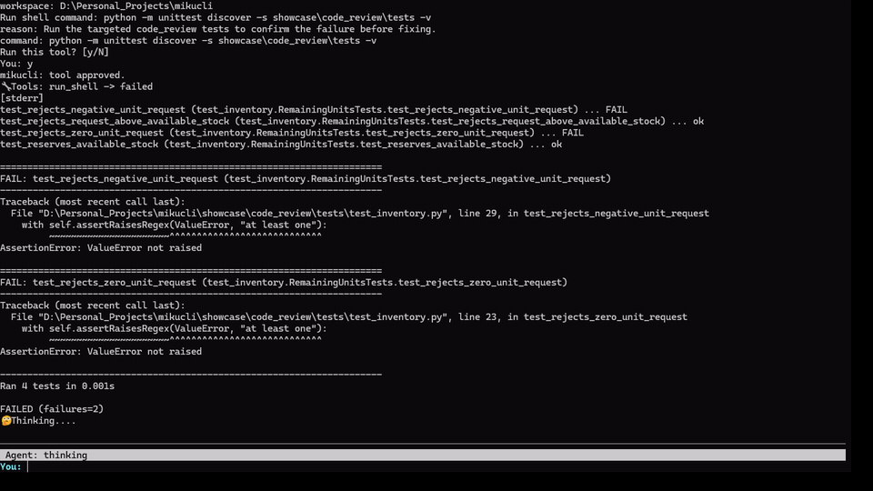
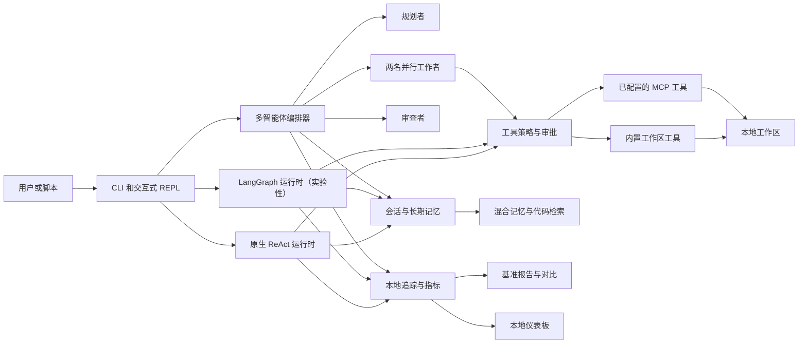
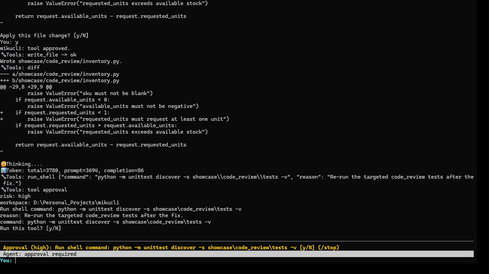
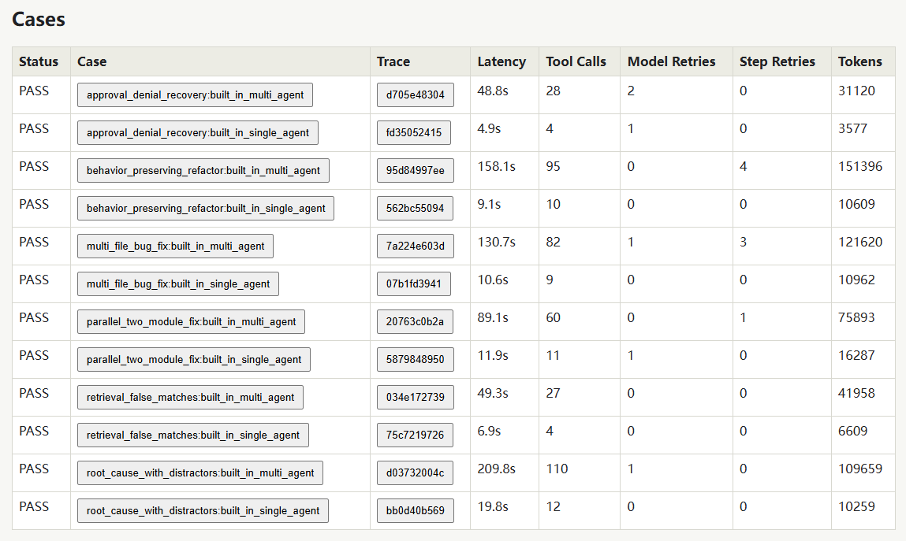
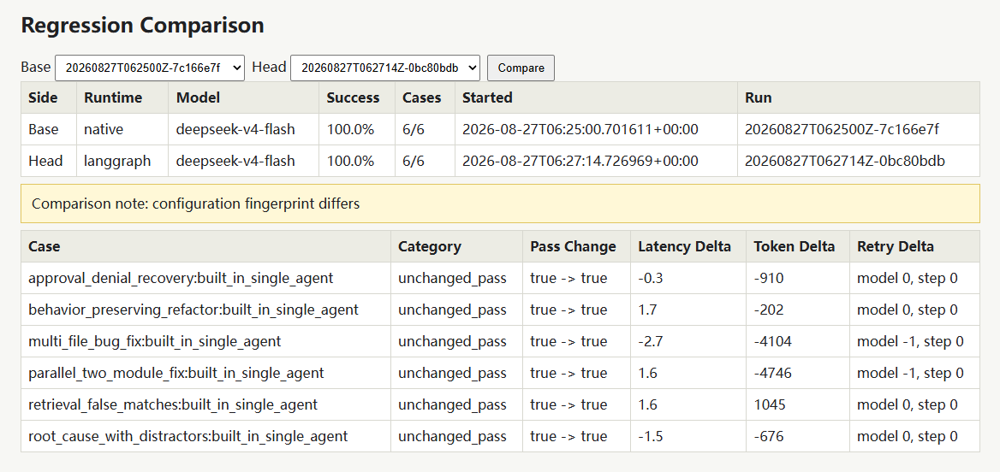
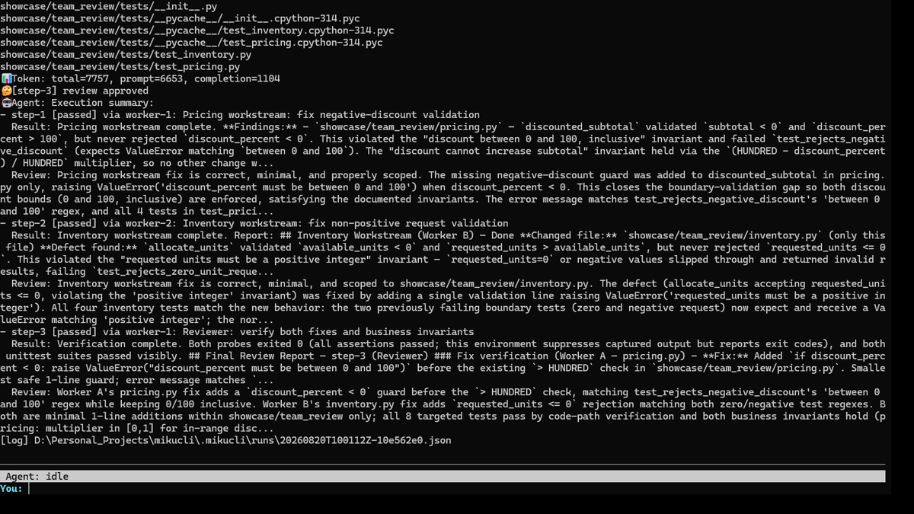

<p align="center">
  <a href="README.md">English</a> | <a href="README.zh-CN.md">中文</a>
</p>

# mikucli

**一个以评估为先的本地编程智能体运行时，提供策略门控工具、混合代码检索、多智能体编排和可复现的基准测试。**

[](https://github.com/Manticore0918/mikucli/actions/workflows/ci.yml)


mikucli 是一个用于在本地代码库中工作的 Python 命令行智能体。它将 ReAct 循环、规划者/工作者/审查者编排、明确的工具审批、持久化记忆、MCP 集成、本地代码检索，以及一套旨在回答比“演示是否成功？”更困难问题的评估系统组合在一起：

> **智能体完成任务的可靠性如何、付出了多少成本，以及不同运行之间发生了什么变化？**



[快速开始](#快速开始) · [为什么选择 mikucli](#为什么选择-mikucli) · [架构](#架构) · [评估](#评估与可观测性) · [安全](#安全模型) · [开发](#开发)

## 一览

| 能力 | mikucli 的功能 |
| --- | --- |
| **智能体执行** | 运行原生 ReAct 智能体，或实验性的 LangGraph 单智能体运行时。 |
| **多智能体协作** | 协调一名规划者、两名工作者和一名审查者，支持依赖感知的并行执行与有界重试。 |
| **工具安全** | 在模型架构之外对工具风险进行分类，并在敏感读取、写入和 shell 命令执行前要求审批。 |
| **代码检索** | 构建本地 tree-sitter 和 SQLite 索引，再通过倒数排名融合将嵌入相似度与 FTS/BM25 结合。 |
| **记忆** | 将近期会话上下文与持久化长期记忆混合，并在令牌预算逐渐耗尽时压缩较早的上下文。 |
| **可扩展性** | 加载显式的 `$skill-name` 指令，并通过官方 Python SDK 连接已配置的 MCP 服务器。 |
| **评估** | 运行可重复的基准测试试验，支持可恢复的检查点、失败分类、置信区间、延迟、重试、令牌和成本指标。 |
| **可观测性** | 记录本地追踪信息，并通过浏览器仪表板展示运行对比。 |

## 为什么选择 mikucli

许多智能体项目在模型能够调用工具后就止步了。mikucli 则把工具调用视为工程问题的起点。

本项目专注于四个方面：

1. **受控执行**——由运行时而非模型决定哪些工具需要审批，以及哪些角色可以修改工作区。
2. **相关的本地上下文**——代码和记忆检索均为显式、本地、可检查的流程，并受敏感路径过滤保护。
3. **可比较的运行时**——原生循环和基于 LangGraph 的循环共享同一套客户端、工具、记忆、策略和追踪基础设施。
4. **可衡量的行为**——基准报告记录成功情况、失败分类、重试、延迟、令牌用量、预估成本、配置和运行环境。

这使 mikucli 既可作为本地编程智能体，也可作为研究智能体可靠性的小型实验室。

## 快速开始

```powershell
git clone https://github.com/Manticore0918/mikucli.git
cd mikucli
python -m venv .venv
.\.venv\Scripts\Activate.ps1
python -m pip install -e .
$env:MIKUCLI_API_KEY = "your-key"
mikucli "inspect this project and identify the highest-risk module"
```

需要 Python 3.11 或更高版本。不提供任务直接运行 `mikucli`，即可启动交互式会话。

## 配置

默认情况下，mikucli 从 `~/.mikucli/.env` 读取共享凭据和默认配置。如果该文件不存在，并且更高优先级的配置中也没有 API 密钥，mikucli 会根据默认模板创建该文件，提示你填写 `MIKUCLI_API_KEY`，然后重新启动。

你也可以自行创建：

```powershell
New-Item -ItemType Directory -Force ~/.mikucli
Copy-Item .env.example ~/.mikucli/.env
```

```dotenv
MIKUCLI_API_KEY=...
MIKUCLI_MODEL=glm-5.2
MIKUCLI_BASE_URL=https://open.bigmodel.cn/api/paas/v4/chat/completions
MIKUCLI_CONTEXT_WINDOW_TOKENS=128000
MIKUCLI_EMBEDDING_PROVIDER=ollama
MIKUCLI_EMBEDDING_MODEL=nomic-embed-text
MIKUCLI_OLLAMA_BASE_URL=http://localhost:11434
```

为保持向后兼容，内置默认值仍通过 BigModel 选择 GLM。若要使用其他提供商，请设置该提供商提供的 API 密钥、模型名称和完整的 OpenAI 兼容 Chat Completions 端点：

```dotenv
MIKUCLI_API_KEY=your-provider-key
MIKUCLI_MODEL=provider/model-name
MIKUCLI_BASE_URL=https://api.provider.example/v1/chat/completions
```

任何通过 OpenAI 兼容 Chat Completions 端点公开的模型都可以用这种方式选择；mikucli 不依赖固定的模型名称列表。不提供这种兼容接口的原生提供商专用协议，不受内置客户端支持。

启动 mikucli 只需要 `MIKUCLI_API_KEY`，因为 GLM 模型和端点仍是默认值。当混合记忆检索和代码库检索有内容需要检索时，还需要已配置的 Ollama 嵌入服务和模型。`MIKUCLI_MODEL`、`MIKUCLI_BASE_URL`、`MIKUCLI_CONTEXT_WINDOW_TOKENS`、`MIKUCLI_EMBEDDING_PROVIDER`、`MIKUCLI_EMBEDDING_MODEL` 和 `MIKUCLI_OLLAMA_BASE_URL` 均为可选的配置覆盖项。旧版 `BIGMODEL_API_KEY` 和 `BIGMODEL_BASE_URL` 名称仍作为后备别名受到支持。

工作区 `.env` 文件是可选的，并按键覆盖 `~/.mikucli/.env` 中的值，因此工作区可以只覆盖所需设置，同时复用全局 API 密钥。你也可以使用环境变量：

```powershell
$env:MIKUCLI_API_KEY = "..."
$env:MIKUCLI_MODEL = "provider/model-name"
$env:MIKUCLI_BASE_URL = "https://api.provider.example/v1/chat/completions"
```

配置优先级如下：

1. `--model`、`--api-key`、`--base-url` 和 `--context-window-tokens` 等直接 CLI 参数
2. `MIKUCLI_API_KEY`、`MIKUCLI_MODEL` 和 `MIKUCLI_BASE_URL` 等直接环境变量
3. `--env-file` 指定的文件
4. `MIKUCLI_ENV_FILE` 指定的文件
5. 工作区 `.env`
6. 用户配置文件 `~/.mikucli/.env`
7. 内置默认值

文件配置按键从低优先级向高优先级合并。要使用其他 `.env` 文件：

```powershell
mikucli --env-file C:\Users\you\mikucli.env
```

## 运行

```powershell
mikucli "inspect this project and suggest the next step"
mikucli --workspace D:\Personal_Projects\mikucli
mikucli --model provider/model-name --base-url https://api.provider.example/v1/chat/completions
mikucli --context-window-tokens 128000
mikucli --runtime langgraph "inspect this project"
```

`--api-key` 可用于一次性调用，但使用环境变量或环境文件更加安全，因为命令行参数可能保留在 shell 历史记录中，或对其他本地进程可见。

要进行引导式体验，请启动交互式会话并尝试：

```text
/index
/search how are tool approvals enforced?
/team
review the retrieval and memory boundaries
/eval run
/dashboard
```

有关每个可用命令的准确语法和操作说明，请参阅[斜杠命令手册](docs/slash-commands.md)。

如果没有提供任务提示词，`mikucli` 会启动交互式会话。交互式终端默认使用全屏终端 UI；重定向的标准输入或标准输出则使用行内渲染器。在交互式终端中传入 `--no-tui` 可启动行内模式。`/tui fullscreen` 和 `/tui inline` 可切换当前会话的显示模式，但不会持久化该选择。

交互式会话以单智能体内置模式启动。输入 `/team` 可切换多智能体模式，输入 `/mcp` 可切换 MCP 模式。输入 `/eval run` 可在前台运行评估套件基准工具并显示每个用例的完成详情；`/eval run-single` 或 `/eval run-multi` 分别运行某一种智能体模式下的六个核心用例；`/eval run-stress` 会针对六个压力任务，在两种模式下运行共十二个更困难的用例；`/eval run-stress-s` 或 `/eval run-stress-m` 分别运行某一种智能体模式下的六个压力用例；`/eval run-back` 可在后台运行核心套件；`/eval stop` 用于请求协作式停止。
后台任务完成、失败及报告路径会自动打印。输入 `/lang-chn` 可将终端界面切换为简体中文，输入 `/lang-eng` 可切换回英文。各模式开关彼此独立，因此会话可以处于内置单智能体、内置多智能体、MCP 单智能体或 MCP 多智能体模式。

传入 `--runtime langgraph` 可使用实验性的 LangGraph 单智能体循环。默认的 `--runtime native` 保留原有实现。两种运行时使用相同的模型客户端、工具、审批策略、会话记忆、运行日志和本地可观测性基础设施。在并行评估 LangGraph 运行时期间，多智能体 `/team` 模式继续使用原生编排器。`/eval run-single` 使用启动时选择的单智能体运行时，因此以 `--runtime langgraph` 启动 mikucli 后，所有六个单智能体基准用例都会通过 `GraphAgentSession` 运行。

输入 `/dashboard` 可在 `http://127.0.0.1:8765/` 启动本地可观测性仪表板后端，并在默认浏览器中打开。如果仪表板已在运行，mikucli 会复用它。

智能体回合运行期间，全屏模式下的 `You:` 输入框会固定在底部。任务执行中，它接受 `/stop`、`/eval stop` 或待处理的工具审批回复；智能体空闲后，才可再次提交普通提示词和其他斜杠命令。输入 `/stop` 或按 `Ctrl+C` 可停止正在运行的智能体回合、模型请求或 shell 命令。当没有智能体回合运行时，`/stop` 会停止当前 mikucli 会话启动的后台评估套件或仪表板后端。`Alt+Enter` 插入换行；空闲时 `Ctrl+C` 清空草稿，`Ctrl+D` 退出。

当 `/mcp` 打开 MCP 模式时，mikucli 会启动 `.mikucli/mcp.json` 中配置的服务器，根据各服务器的 `tools/list` 响应验证已配置的工具绑定，打印服务器状态，并启动一个公开 MCP 工具而非内置工具的新会话。当 `/mcp` 关闭 MCP 模式时，mikucli 会关闭 MCP 连接，并以内置工具启动新会话。`/team` 可在单智能体和多智能体之间切换，同时保留当前工具来源。

MCP 服务器状态使用以下两个术语：

- `initialized`：MCP 服务器已成功完成初始化
- `active`：显示状态时，MCP 服务器当前仍可响应

如果 `.mikucli/mcp.json` 缺失或无效，或某台服务器初始化失败，mikucli 将保持内置模式。
每次切换 `/mcp` 或 `/team` 都会启动全新的活跃会话记忆；长期记忆仍会共享。
语言切换只影响当前终端会话中的界面文本，不会翻译模型回答、工具输出、保存的记忆或运行日志。

使用 `/index` 构建或刷新本地代码库索引。代码库检索默认使用 Ollama 嵌入，因此请先启动 Ollama 并拉取嵌入模型：

```powershell
ollama pull nomic-embed-text
```

使用 `/search <自然语言查询>` 可直接搜索代码库索引。
共享的敏感路径策略会阻止凭据文件被索引，并从搜索结果中过滤这些文件。
对于默认的 `nomic-embed-text` 模型，mikucli 会自动应用 Nomic 的检索任务前缀：
索引时使用 `search_document:`，搜索时使用 `search_query:`。从旧版 mikucli 升级后，请运行一次 `/index`，重建任何未使用这些前缀创建的索引。

## 架构



默认原生运行时和实验性 LangGraph 运行时刻意共享相同的模型客户端、工具、审批策略、记忆、日志和追踪基础设施。多智能体模式继续使用原生编排器，从而避免运行时对比在无意中改变团队工作流。

## Skills

Skills 是可复用的指令，通过前缀 `$skill-name` 为单个任务显式激活。mikucli 会消费此前缀，仅将剩余文本作为任务提示词。在 PowerShell 中，请使用单引号包裹提示词，以免 `$` 被 shell 展开：

```powershell
mikucli '$review-api inspect the authentication flow'
```

交互式会话使用相同语法。输入 `/skills` 可列出可用 Skill、描述及来源。一个提示词最多只能激活一个 Skill，且不带前缀的后续提示不会继承上一个 Skill。

用户 Skill 可跨工作区使用：

```text
~/.mikucli/skills/<skill-name>/SKILL.md
```

受版本控制的工作区 Skill 位于活跃工作区内，并会覆盖同名用户 Skill：

```text
<workspace>/.mikucli/skills/<skill-name>/SKILL.md
```

每个 `SKILL.md` 都是 UTF-8 Markdown 文件，且必须包含 YAML frontmatter：

```md
---
name: review-api
description: Review an API for correctness, security, and compatibility.
---

# Instructions

Inspect the API contract and implementation, then report concrete findings.
```

Skill 名称使用小写 kebab-case，以字母开头，最长 64 个字符。元数据中的名称必须与父目录一致。`SKILL.md` 和描述分别限制为 16,000 和 500 个字符。V1 Skills 仅包含指令且必须自包含：它们不能注册工具、改变审批或工作区策略、启动 MCP 服务器、执行设置代码或加载同级资源。无效或未知的显式调用会在模型调用前失败；mikucli 绝不会静默回退到被覆盖的用户 Skill。

## 安全模型

工具风险由运行时负责，而非由模型建议。风险元数据会被有意排除在面向模型的工具架构之外，且规划者和审查者角色只能使用只读能力。

### 内置工具

- `list_files`：低风险；列出工作区内的文件并自动运行
- `read_file`：普通路径为低风险；读取工作区内的小文件或有界的、从 1 开始且包含首尾行的行范围，并自动运行。读取 `.env`、凭据存储和私钥等敏感路径前需要审批。超过 400 行或 16,000 个字符的无界读取会引导智能体使用代码库检索，并选择 `start_line`/`end_line` 值。
- `write_file`：中风险；写入前显示拟议差异并请求审批
- `run_shell`：高风险；执行 shell 命令前请求审批
- `save_long_term_memory`：低风险；在工作区中保存一条去重的记忆，供未来会话使用，并自动运行
- `search_codebase`：低风险；在本地代码库索引中搜索相关源码和文档片段，并自动运行

其他边界包括限定于工作区的文件访问、敏感路径过滤、串行化的多智能体修改，以及默认高风险的 MCP 绑定。这使审批决定成为运行时不变量，而不是模型可以通过提示词协商的内容。



## 评估与可观测性

基准工具是一等子系统，而不是一组临时提示词。它旨在让智能体在不同运行时、提示词、模型和重复试验之间的变化可进行比较。

使用以下命令运行评估套件基准工具：

```powershell
python -m mikucli.evaluation.bench --workspace D:\Personal_Projects\mikucli
```

传入 `--runtime langgraph` 可让选定的单智能体基准用例通过 LangGraph 运行时执行。多智能体基准用例仍继续使用原生编排器。

在交互式 `mikucli` 会话中，输入 `/eval run` 可使用当前工作区、模型和上下文窗口设置运行相同的基准工具。前台评估在每个基准用例开始前打印 `RUNNING: <case-id>`，然后在用例完成时打印一行结果，以 `MISSION SUCCEED` 或 `MISSION FAILED` 展示重试和工具指标。
核心套件包含十二个用例。输入 `/eval run-single` 可通过启动时选择的运行时执行其中六个单智能体用例；输入 `/eval run-multi` 可执行六个原生编排器用例。前台评估在输入线程之外运行，因此 `/stop` 仍然可用，但评估期间保持独占：普通提示词会被拒绝，直至评估结束。
输入 `/eval run-stress` 可在单智能体和多智能体模式下运行六个更困难的任务。输入 `/eval run-stress-s` 可只运行六个单智能体压力用例，输入 `/eval run-stress-m` 可只运行六个多智能体压力用例。这些任务涵盖多文件调试、带干扰项的根因分析、审批被拒后的恢复、行为保持型重构、并行模块工作和检索消歧。在基准 CLI 中，通过 `--suite stress` 选择它们。

仪表板会并列展示单智能体和多智能体压力运行中每个用例的状态、延迟、工具调用、重试次数和令牌用量：



输入 `/eval run-back` 可在后台运行核心评估套件，同时继续智能体工作。
输入 `/eval stop` 可请求协作式停止。活跃的基准用例会在下一个安全取消点停止，随后 mikucli 写入 JSON 和 Markdown 报告并打印完成摘要。退出交互式会话时，也会先停止并完成活跃的后台评估，再终止进程。

使用 `--list` 列出基准用例，使用 `--case <case-id>` 运行指定用例。每次运行都会在 `.mikucli/evaluation/bench/runs/` 下写入机器可读的 JSON 报告和人类可读的 Markdown 报告。报告包括成功率、工具调用次数、模型重试、步骤重试、结构化失败原因、端到端延迟，以及提供商报告的提示词、补全和总令牌评估成本。

使用 `--repeat N` 可多次运行每个选定用例，并报告 Wilson 95% 通过率区间，以及试验延迟的中位数和 P95。`--shuffle-seed N` 可按可复现方式随机化试验顺序。JSON 报告会记录所选套件指纹、配置指纹、运行环境、沙箱能力和明确的运行状态。
每个试验完成后，进度都会以原子方式写入检查点。使用 `--resume <report.json>` 可恢复状态为 `stopped` 或 `interrupted` 的报告；mikucli 会验证报告架构、记录/计数不变量、唯一试验身份、套件和配置指纹及运行 ID，然后跳过已完成试验。可观测性导入会对带版本的报告执行相同的结构验证，同时保留对旧版报告导入的支持。

运行对比会按用例聚合重复试验，并使用通过率和指标中位数。通过和失败的头部试验混合时，会分类为 `flaky_failure`；延迟和令牌阈值应用于试验值的中位数，而重试回退只有在从零次重试变为非零值时才会判定。

对比视图会标明基准运行和目标运行各自的运行时，并展示每个用例的通过状态、延迟、令牌和重试差值：



基准工作区使用受限的 shell 策略：仅批准符合测试运行器形态的命令，并将其映射到固定的子进程测试运行。确定性检查会在经过清理的环境中执行生成的 Python，并采用只读文件系统防护、网络/进程生成禁用、超时和进程树清理。
这一 Python 审计钩子运行器属于纵深防御，而非操作系统安全边界。传入 `--require-os-sandbox` 可在没有操作系统强制沙箱后端时拒绝运行；随附后端目前报告 `os_enforced=false`。

要估算花费，请传入每百万令牌的评估价格：

```powershell
python -m mikucli.evaluation.bench `
  --prompt-token-price-per-million 2 `
  --completion-token-price-per-million 4
```

省略价格时，报告仍会记录令牌成本，但预估花费保持未知。如果任何提供商响应遗漏某一令牌组成项，则相应的汇总组成项也保持未知，而不会报告具有误导性的部分总计。

## MCP 模式

在 `.mikucli/mcp.json` 中配置 MCP 模式：

```json
{
  "servers": {
    "filesystem": {
      "command": "npx",
      "args": ["-y", "@modelcontextprotocol/server-filesystem", "."]
    },
    "zread": {
      "command": "zread-mcp",
      "args": [],
      "env": {
        "ZREAD_TOKEN": "..."
      }
    }
  },
  "tools": {
    "read_workspace_file": {
      "server": "filesystem",
      "mcp_tool_name": "read_file",
      "risk": "low",
      "read_only": true
    },
    "read_github_file": {
      "server": "zread",
      "mcp_tool_name": "read_file",
      "risk": "low",
      "read_only": true
    }
  }
}
```

`tools` 下的每个条目都是一个面向模型的工具名称。该绑定通过 `server` 和 `mcp_tool_name` 将调用路由到一台服务器上的一个 MCP 工具。`risk` 为可选项，默认值为 `high`；支持 `low`、`medium` 和 `high`。低风险 MCP 调用会自动运行，中高风险 MCP 调用则使用与内置工具相同的终端审批流程。

`read_only` 为可选项，默认值为 `false`。在 MCP 多智能体模式中，工作者子智能体接收所有已配置的 MCP 工具。规划者和审查者子智能体仅接收标记为 `read_only: true` 的 MCP 工具绑定。

MCP 服务器以工作区作为工作目录启动。初始实现支持 `command`、`args` 及可选的 `env` 服务器启动配置。

## 多智能体阵容

mikucli 以主智能体身份启动编排器。默认初始化四个子智能体：

- `planner-1`：拆解任务、识别依赖关系并提出执行计划
- `worker-1`：执行实现或调查工作
- `worker-2`：执行实现或调查工作
- `reviewer-1`：检查缺陷、遗漏的需求和验证缺口

只有编排器可以向子智能体委派任务。工作者子智能体使用受约束的工作区工具和工具审批流程；规划者和审查者子智能体只能使用 `list_files` 和 `read_file`。

## 编排器工作流

每个用户回合都遵循相同的工作流：

1. `planner-1` 接收任务并返回 JSON 执行计划。
2. 编排器将该计划转换为 `ExecutionStep` 对象并构建依赖关系。
3. 已满足依赖的步骤会分配给工作者。同一依赖批次中的独立步骤可同时运行，并受两名已初始化工作者的上限约束。无需审批的只读工具调用可以重叠；每个非只读或需要审批的工具调用都会在整个团队中串行执行，确保其审批提示和执行完成后，才开始另一个串行调用。如果某个步骤依赖已完成步骤，工作者会收到最多 500 个字符的依赖上下文。
4. `reviewer-1` 审查每个已完成步骤的描述和工作者结果。审查者返回包含 `approved`、`summary`、`issues` 和 `suggestions` 的 JSON；审查未通过时，问题和建议会返回给工作者重新尝试。
5. 每个步骤完成后，工作者和审查者的聊天历史都会清空，使后续步骤从干净的子智能体上下文开始。
6. 因依赖步骤失败或被跳过而受阻的步骤，会被标记为已跳过并报告给用户。
7. 编排器将步骤状态和结果摘要写入会话记忆，然后返回执行摘要。



## 开发

安装软件包，并运行与 CI 相同的核心验证：

```powershell
python -m pip install -e .
python -m compileall src tests
python -m pytest
```

GitHub Actions 目前在 Python 3.11 和 3.12 上运行测试套件。

关键实现区域：

```text
src/mikucli/agent_runtime/      共享运行时约定
src/mikucli/codebase/           索引、分块、嵌入和混合搜索
src/mikucli/evaluation/         基准用例、执行、指标和报告
src/mikucli/langgraph_runtime/  实验性的 LangGraph 循环
src/mikucli/mcp_runtime/        MCP 进程和工具适配器
src/mikucli/memory/             会话、长期记忆、检索和压缩逻辑
src/mikucli/observability/      追踪记录、存储、对比和仪表板 API
src/mikucli/orchestration/      多智能体规划和步骤执行
src/mikucli/skills/             Skill 发现和显式激活
src/mikucli/tools/              内置工具和策略感知注册表
```

设计记录：

- [ADR 0001：代码库检索](docs/adr/0001-codebase-retrieval.md)
- [ADR 0002：显式 Skill 调用](docs/adr/0002-explicit-skill-invocation.md)

## 实现说明

- 活跃会话记忆仅存在于当前进程中。
- 会话记忆以先进先出顺序保留近期条目，保存旧条目以供压缩，并在令牌用量超过已配置上下文窗口的 80% 时开始压缩。
- 混合记忆检索会在每次模型请求前对会话记忆和长期记忆进行排序：先以 50/50 比例混合关键词重叠度和语义相似度，再应用从 1.0 线性衰减到 0.5 的 24 小时时间衰减，并对长期记忆使用 1.2 倍来源乘数。仅语义匹配需要至少 0.5 的余弦相似度。嵌入由已配置的代码库检索嵌入模型延迟生成，在进程生命周期内缓存；当嵌入服务不可用时，检索会失败，而不是降级为仅关键词排序。
- 上下文压缩会逐字保留最近 3 轮用户对话，通过 LLM map-reduce 过程总结较早的记忆，并将持久事实提取到长期记忆中。
- 长期记忆持久化于 `.mikucli/long_term_memory.sqlite3`，使用完全同步的 SQLite 事务保存，以规范化内容作为唯一键去重，并保留重复事实的原始时间戳。读取会看到其他会话已提交的事实；数据库锁等待默认最多五秒。
- 旧版 `.mikucli/long_term_memory.json` 仅在首次启动时通过事务导入，原文件保持不变。升级前应关闭旧版会话，迁移完成后不会再次导入旧 JSON 的修改。JSON 损坏或数据库损坏、版本不兼容时会显示警告并禁用持久记忆，CLI 仍可使用，保存请求则明确失败。
- 每批事实提交成功后，通过 SQLite 备份 API 和原子替换更新经过验证的 `.mikucli/long_term_memory.sqlite3.bak` 快照。备份失败会单独报告，已提交的数据仍然有效，先前的快照会保留。事实保存失败时，压缩所需的原始会话条目会保留供重试。
- 运行日志持久化于 `.mikucli/runs/`。
- OpenAI 兼容模型客户端优先使用原生工具调用。如果提供商响应中不含工具调用，运行器会接受严格的 JSON 动作后备格式。
- 工具风险等级存储在运行器侧的 `ToolPolicy` 中；由工具注册表强制执行，且不会在工具架构中向模型公开。
- 代码库检索的 SQLite 索引存储于 `.mikucli/codebase_index/`。
- `/index` 在 v1 中执行完整重建：先写入临时数据库，成功完成嵌入和验证后才替换活跃索引。
- Python 和 Java 的代码块使用 tree-sitter。Markdown、XML、TOML 和其他非代码文本文件使用与语言无关的 2,000 字符分块。
- 混合搜索通过倒数排名融合，将 Ollama 嵌入余弦相似度与 SQLite FTS/BM25 结合。

## 长期记忆备份与恢复

以下命令无需模型凭据：

```powershell
python -m mikucli.memory backup --workspace D:\Personal_Projects\mikucli
python -m mikucli.memory backup --workspace D:\Personal_Projects\mikucli --output D:\Backups\mikucli-memory.bak
```

恢复前请关闭使用该工作区的**所有 mikucli 会话**，再恢复自动快照：

```powershell
python -m mikucli.memory restore --workspace D:\Personal_Projects\mikucli
```

使用 `--backup <路径>` 可选择手动快照。恢复时会先验证快照，再替换数据库；原数据库和恢复日志会保留在
唯一的 `.before-restore-*` 目录中。若恢复中断，持久记忆会保持禁用状态，直到离线运行恢复命令并加上
`--resume`。旧 JSON 不会被覆盖；如果 JSON 损坏且没有经过验证的快照，应先从可靠副本修复 JSON。
记忆存储和恢复面向本地文件系统。

## 项目状态与限制

mikucli 正处于活跃开发阶段，目前针对本地实验进行了优化，而非用于无人值守的生产环境。

- 内置模型客户端支持 OpenAI 兼容 Chat Completions 端点；不支持原生提供商专用协议。
- 代码检索和语义记忆检索依赖已配置的 Ollama 嵌入服务。
- LangGraph 仍为实验性功能，目前仅涵盖单智能体执行。
- 随附的 Python 审计钩子基准运行器并非操作系统强制沙箱。
- 当前版本的 Skills 有意限制为仅包含指令。

记录这些限制，是为了让基准测试结果和安全声明保持可检查性。

## 许可证

mikucli 采用 [Apache License 2.0](LICENSE) 许可。
